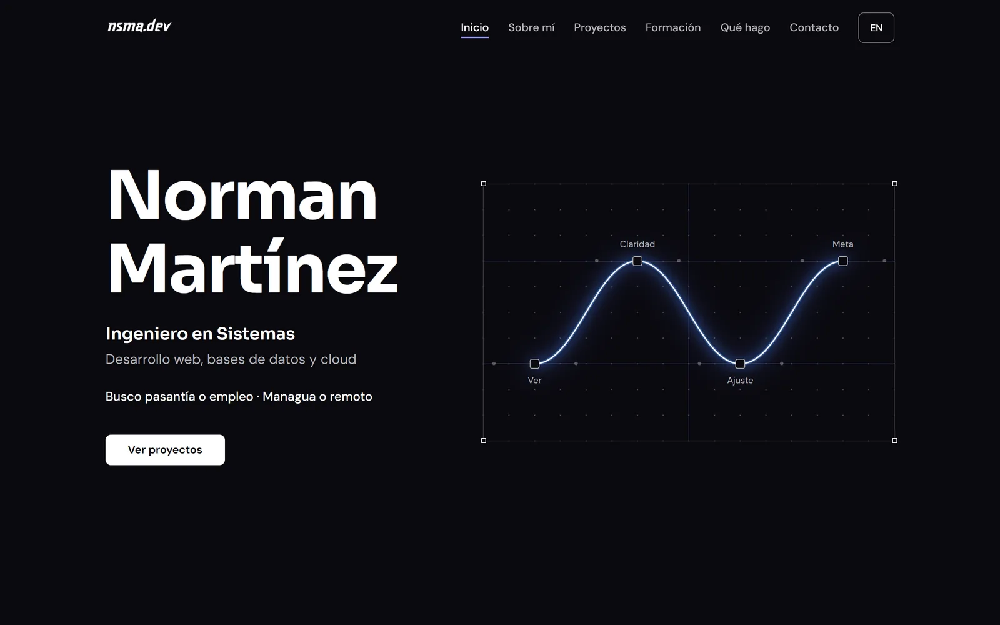

# Norman Martínez

**Ingeniero en Sistemas · Desarrollo web, bases de datos y cloud**

Busco pasantía o empleo. Managua o remoto.

 

## Contacto

- Correo: [norman.martinez003@gmail.com](mailto:norman.martinez003@gmail.com)
- GitHub: [NormanSMA](https://github.com/NormanSMA)
- LinkedIn: [norman-martinez](https://www.linkedin.com/in/norman-martinez)

Licencia MIT · © 2026 Norman Martínez

